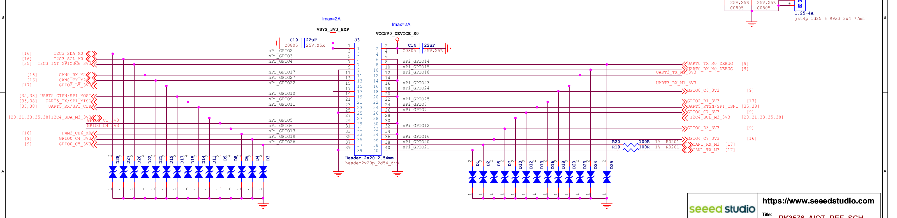
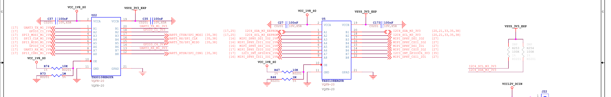

[English](schematic-mapping.md) | [简体中文](schematic-mapping.zh-CN.md)

# V1.0 J3 40-pin：原理图到 SoC 映射

适用于 RK3576-20/30 整机 DevKit 的 V1.0 参考设计。已目视追踪官方 PDF 第 35 页 J3 连线和 U5/U22 电平转换器，并交叉核对第 9、16、17 页的 SoC pad、电源域与缓存 pinctrl。第 25 页补充 EEPROM 分支；不把 PDF 日期当作目标 PCB revision 的独立测量。

本页提供静态原理图与源码映射，不包含设备测量或运行记录。实际接线前确认当前产品、PCB revision、方向和外接电路。结构化40针数据见[schematic-mapping.yaml](schematic-mapping.yaml)，原始标签见[官方标注](official-pinout.zh-CN.md)。

## 信号针映射

offset 是指定 GPIO bank 内的局部 line 下标。表中的 gpio0/2/3/4 是控制器身份标签，不是永久 `/dev/gpiochipN` 名称；每次从 DT 地址、label、line 数核实实际设备。功能列是源码 mux 候选，不表示当前已启用或允许同时使用。

| J3 针脚 | 原理图排针侧 net | SoC pad | 控制器 / offset | 路径 | 已核对的复用候选 |
|---|---|---|---|---|---|
| 3 | `I2C3_SDA_M0` | `GPIO4_B4` | gpio4 / 12 | 直连 3.3V | i2c3m0:SDA |
| 5 | `I2C3_SCL_M0` | `GPIO4_B5` | gpio4 / 13 | 直连 3.3V | i2c3m0:SCL |
| 7 | `I2C3_INT_GPIO3C6_3V3` | `GPIO3_C6` | gpio3 / 22 | U5:A7-B7，1.8↔3.3V | GPIO |
| 8 | `UART0_TX_M0_DEBUG` | `GPIO0_D4` | gpio0 / 28 | 直连 3.3V | uart0m0:TX |
| 10 | `UART0_RX_M0_DEBUG` | `GPIO0_D5` | gpio0 / 29 | 直连 3.3V | uart0m0:RX |
| 11 | `CAN0_RX_M2` | `GPIO4_A6` | gpio4 / 6 | 直连 3.3V | can0m2_pins:RX |
| 12 | `UART3_TX_M1_3V3` | `GPIO4_A0` | gpio4 / 0 | U22:A1-B1，1.8↔3.3V | uart3m1:TX |
| 13 | `CAN0_TX_M2` | `GPIO4_A4` | gpio4 / 4 | 直连 3.3V | can0m2_pins:TX |
| 15 | `GPIO2_B5_3V3` | `GPIO2_B5` | gpio2 / 13 | 直连 3.3V | GPIO |
| 16 | `UART3_RX_M1_3V3` | `GPIO4_A1` | gpio4 / 1 | U22:A7-B7，1.8↔3.3V | uart3m1:RX |
| 18 | `GPIO0_C6_3V3` | `GPIO0_C6` | gpio0 / 22 | 直连 3.3V | GPIO |
| 19 | `UART5_CTSN/SPI_MOSI` | `GPIO3_D6` | gpio3 / 30 | U22:A3-B3，1.8↔3.3V | spi3m1_pins:MOSI、uart5m0_ctsn:CTS |
| 21 | `UART5_TX/SPI_MISO` | `GPIO3_D5` | gpio3 / 29 | U22:A5-B5，1.8↔3.3V | spi3m1_pins:MISO、uart5m0:TX |
| 22 | `GPIO2_B1_3V3` | `GPIO2_B1` | gpio2 / 9 | 直连 3.3V | GPIO |
| 23 | `UART5_RX/SPI_CLK` | `GPIO3_D4` | gpio3 / 28 | U22:A4-B4，1.8↔3.3V | spi3m1_pins:CLK、uart5m0:RX |
| 24 | `UART5_RTSN/SPI_CSN1` | `GPIO3_D7` | gpio3 / 31 | U22:A8-B8，1.8↔3.3V | spi3m1_csn1:CS1、uart5m0_rtsn:RTS |
| 26 | `GPIO0_C7_3V3` | `GPIO0_C7` | gpio0 / 23 | 直连 3.3V | GPIO |
| 27 | `I2C4_SDA_M3_3V3` | `GPIO3_B7` | gpio3 / 15 | U5:A1-B1，1.8↔3.3V | i2c4m3:SDA |
| 28 | `I2C4_SCL_M3_3V3` | `GPIO3_C0` | gpio3 / 16 | U5:A2-B2，1.8↔3.3V | i2c4m3:SCL |
| 29 | `GPIO3_C1_3V3` | `GPIO3_C1` | gpio3 / 17 | U22:A2-B2，1.8↔3.3V | GPIO |
| 31 | `GPIO3_C4_3V3` | `GPIO3_C4` | gpio3 / 20 | U22:A6-B6，1.8↔3.3V | GPIO |
| 32 | `GPIO0_D3_3V3` | `GPIO0_D3` | gpio0 / 27 | 直连 3.3V | pwm2m0_ch0:PWM |
| 33 | `PWM2_CH6_M0` | `GPIO4_A7` | gpio4 / 7 | 直连 3.3V | pwm2m0_ch6:PWM |
| 35 | `GPIO0_C4_3V3` | `GPIO0_C4` | gpio0 / 20 | 直连 3.3V | GPIO |
| 36 | `GPIO4_C7_3V3` | `GPIO4_C7` | gpio4 / 23 | 直连 3.3V | GPIO |
| 37 | `GPIO0_C5_3V3` | `GPIO0_C5` | gpio0 / 21 | 直连 3.3V | GPIO |
| 38 | `CAN1_RX_M3` | `GPIO3_A3` | gpio3 / 3 | R20:100ohm 串联 | can1m3_pins:RX |
| 40 | `CAN1_TX_M3` | `GPIO3_A2` | gpio3 / 2 | R19:100ohm 串联 | can1m3_pins:TX |

## 共享与复用限制

- J3-24为SPI3 m1 CS1；J3-26接GPIO0_C7，不能因官方功能标签而当作SPI3 CS0。源码CS0的GPIO3_B6经R89接GMAC0_TXCLK，不是J3信号。
- J3-27/28为I2C4 m3，经U5连接共享板内总线；控制器地址为2ac70000，GPIO3 bank地址2ae30000用途不同。J3-3/5才是I2C3 m0。固定外部器件地址需先确认，不能扫描或强制访问内核占用地址。
- J3-32为GPIO0_D3/PWM2_CH0_M0，J3-33为GPIO4_A7/PWM2_CH6_M0；从当前provider定位节点，不使用风扇PWM代替。
- 当前mux、consumer和方向需运行时检查；unclaimed不表示电气安全或允许输出。

## 电源与电平

- 1/17 接 `VSYS_3V3_EXP`，标称 3.3V；2/4 接 `VCC5V0_DEVICE_S0`，标称 5V；6/9/14/20/25/30/34/39 为 GND。
- 排针信号侧按原理图为标称 3.3V。上表经过 U5/U22 的 SoC 侧为 1.8V，不能绕过电平转换器按 SoC 电源推断排针电平。U5/U22 型号标注 TXS0108E，尚未验证具体负载、方向切换和速率。
- 本页是静态文档映射，不提供物理电压、最大输入、5V容限或GPIO驱动电流的验收依据；5V 电源针不证明信号可承受 5V。原理图电源轨 `Imax=2A` 不是每针可取 2A 或现场剩余供电预算的承诺。
- CAN 针脚是控制器 TX/RX 逻辑信号，不能直接当作 CAN_H/CAN_L 接总线。

## 运行时关联的边界

重新核对当前fiq-debugger、SPI3、I2C4等owner，不能继承旧GPIO列表。unclaimed不证明电气安全、外接状态、方向或可用性；错误PIN_*标签对应pad的系统功能不能归到同号J3针脚。

选择具体针脚和外接器件，补足方向、电气与负载条件后，只做对应有界功能验收。静态文档不申请 line、输出电平、启用 overlay、扫描 I2C、修改服务或重启。

## 原理图局部证据

以下为官方 PDF 第 35 页等比例渲染裁剪，未重画连接关系；完整页和第 9/16/17/25 页通过 `source.seeed-schematic-v1` 的官方 URL、工作区原件路径和摘要追溯。图示方向是原理图布局，不是实板朝向。

